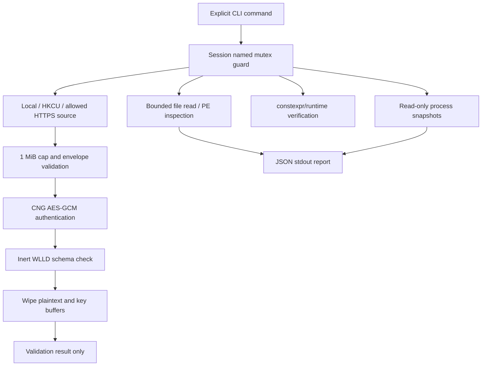

# Data flow

Ciphertext may be stored as a fixture. Plaintext exists only in application-owned non-executable memory. Authentication failure exits without calling the schema validator. A successful schema check records success without exporting its content.

[Project home](../README.md) · [Implementation status](../00_PROJECT_MANAGEMENT/IMPLEMENTATION_STATUS.md)
